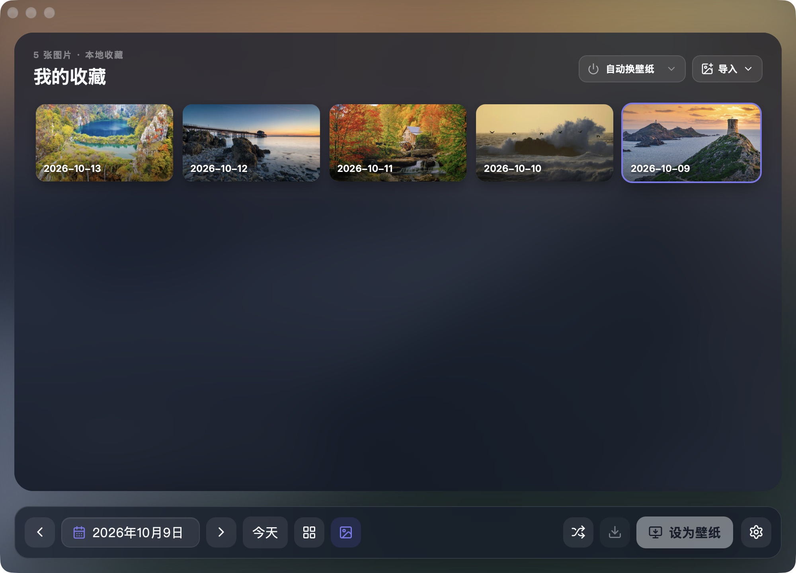
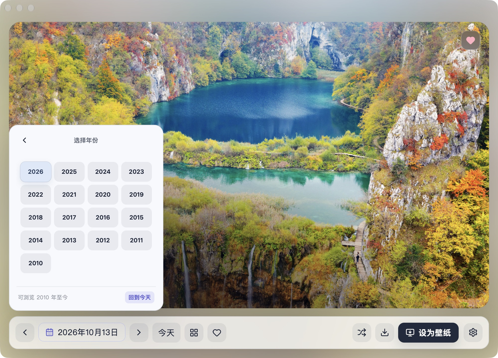

# 必应壁纸 · My Bing Wallpaper

[](https://github.com/hanhuang22/mybingwallpaper/actions/workflows/desktop-build.yml)
[](https://github.com/hanhuang22/mybingwallpaper/actions/workflows/release.yml)

每天从必应壁纸档案中挑选、预览和应用桌面壁纸。应用使用 Tauri 2、React、TypeScript 与 Rust，支持 Windows 和 macOS。

[项目网站](https://hanhuang22.github.io/mybingwallpaper/) · [GitHub 下载](https://github.com/hanhuang22/mybingwallpaper/releases) · [Gitee 国内下载](https://gitee.com/Hyman25/mybingwallpaper/releases)

当前稳定版为 **v1.2.6**。浏览每日与历史壁纸，收藏喜欢的照片，也可以导入自己的图片，让桌面按你的选择自动换新。

本版精简设置页面，按壁纸、通用和软件更新分组，合并 Windows 锁屏选项与系统设置入口，并优化标题、间距和底部链接。以下为 macOS 实机截图；Windows 版窗口控件保留平台习惯，额外提供锁屏设置。

## 界面预览


<table>
  <tr>
    <td width="50%"></td>
    <td width="50%"></td>
  </tr>
  <tr>
    <td align="center">月览：整月缩略图，点击进入大图</td>
    <td align="center">收藏：本地副本、图片导入与轮播</td>
  </tr>
  <tr>
    <td width="50%"></td>
    <td width="50%"></td>
  </tr>
  <tr>
    <td align="center">按年份、月份和日期浏览历史壁纸</td>
    <td align="center">外观、保存位置与自动更新设置</td>
  </tr>
</table>

## 功能

- 当日、历史日期和随机壁纸浏览
- 按月浏览网格缩略图，点击后平滑进入大图；新档案优先请求小尺寸图片，减少一次查看整月时的传输与内存占用
- 本地收藏与图片导入：收藏必应壁纸，或选择图片/文件夹导入；保留原图副本并生成独立的小尺寸缩略图
- 保存原图直接写入设置的保存位置，可随时打开或更换文件夹
- Windows 与 macOS 桌面壁纸设置
- 系统托盘/菜单栏常驻，左键打开主界面、右键打开菜单；可直接进入设置，关闭窗口不退出
- Windows 单实例运行：再次双击快捷方式或点击开始菜单时唤起已有窗口，不会重复创建后台进程和托盘图标
- 每日自动更新与登录后自动启动
- 自动换壁纸统一选择必应每日、收藏顺序循环或收藏随机；同一时间只运行一个模式
- Windows 锁屏壁纸实验功能
- 壁纸说明按需展开，也可收起标题与局部阴影，完整预览图片
- 图片区域不显示浏览器右键菜单；页码等输入框保留原生复制、粘贴菜单
- 跟随系统浅色/深色外观，也可在设置中手动覆盖
- 签名校验的软件更新，可自动下载并由用户决定何时重启安装
- GitHub 与 Gitee 并行检查软件更新；优先使用检查窗口内的最新有效版本，同版本优先选择先响应的来源。下载失败或连续 20 秒无进展时自动尝试另一来源，不并行下载两份完整安装包，不切换到不同版本或签名的包
- 收藏页一键打开收藏图片文件夹
- 可缩放现代界面与高 DPI 适配

macOS 没有公开的锁屏壁纸设置接口，因此不会显示可用的锁屏开关。Windows 锁屏功能使用当前用户接口，无需管理员权限。要让设置的图片显示出来，请先在 Windows「设置 → 个性化 → 锁屏界面」中将锁屏背景从「Windows 聚焦」改为「图片」；「Windows 聚焦」会继续显示系统提供的图片。系统策略仍可能阻止修改。锁屏设置失败时不会影响桌面壁纸自动更新。

点击底栏的下载图标（保存原图），直接保存到设置中的“原图保存位置”，默认是系统“图片/MyBingWallpaper”文件夹，不再逐次询问位置。必应壁纸文件名为壁纸日期（如 `2026-09-24.jpg`）。设置中可打开或更改保存位置，更改位置不会搬动此前保存的图片。旧版选择的保存文件夹仍会保留。

主界面底栏的网格图标打开月览，可浏览当月所有壁纸，左右箭头切换月份，点击缩略图后返回对应日期的大图。月览只预取进入可视区域的缩略图；必应图片服务支持的档案会请求 320×180 图片。部分早期档案使用其他图片源，不支持尺寸参数，仍会按需加载原图。当月 JSON 尚未收录今日壁纸时，月览可暂用单图预览已获取的 Bing 壁纸；JSON 更新后仍以 JSON 记录为准。

预览图右上角的心形按钮收藏当前图片，底栏的心形图标打开“我的收藏”。收藏页可导入一张或多张图片，也可导入文件夹里的 JPG、PNG、WebP、BMP 图片（不扫描子文件夹）。导入和收藏的图片统一保存在独立的收藏库，与“保存原图”的位置不同；点击收藏页右上角的文件夹图标即可打开收藏图片文件夹。想将收藏图片另存到自己的目录时，打开大图后点击“保存原图”。

收藏原图位于应用数据目录的 `favorites/images`，400×225 缩略图位于 `favorites/thumbnails`；相同内容不会重复加入。移动或删除导入来源不影响收藏；移除收藏只删除应用自己的副本，不删除来源图片，已经应用到桌面的图片也会保留。壁纸和月度 JSON 缓存由应用内部管理，设置中不再提供缓存目录入口。

收藏页右上角的“自动换壁纸”与主设置共用同一模式：关闭、每日必应、收藏循环、随机收藏。选择收藏播放后，可在菜单内设置更换间隔或点“换一张”。收藏超过 30 张时分页显示，支持上一页、下一页及输入页码后按回车跳转；翻页只加载当前页的缩略图，后台播放仍使用全部收藏。

旧版开启每日更新的设置会自动迁移到“每日必应”。收藏按加入顺序循环，随机播放不会连续重复同一张（只有一张时除外）；可选择每 15 分钟、每小时、每 6 小时或每天更换，默认每天（本地日期改变后更换）。切换到收藏模式立即应用一张；手动设为壁纸后重新计时，“每天”模式当天不覆盖手动选择，其他间隔到期后继续播放。收藏循环进度会跨重启保留，移除最后一张时自动关闭播放，桌面保留当前图片。自动换壁纸需要应用在后台运行，关闭主窗口不影响播放。

## 下载

从 [GitHub](https://github.com/hanhuang22/mybingwallpaper/releases/latest) 或 [Gitee 国内下载](https://gitee.com/Hyman25/mybingwallpaper/releases) 选择适合你电脑的安装包。当前仅提供 Windows x64 `.exe` 和 macOS Apple Silicon `.dmg`，历史版本仍保留在发布页。

若此前使用 MSI 安装，切换到 NSIS `.exe` 时建议先卸载旧版 MSI，再安装新版，以免 Windows 的“已安装的应用”中留下重复记录。

| 文件名格式 | 适用系统 |
| --- | --- |
| `mybingwallpaper-v<版本>-windows-x64-setup.exe` | Windows 10/11，Intel 或 AMD 64 位（推荐安装程序） |
| `mybingwallpaper-v<版本>-macos-apple-silicon.dmg` | macOS 12 及以上，Apple Silicon Mac（M 系列） |

其他附件（`.sig`、`.app.tar.gz`、`latest.json`）供应用内更新使用，无需手动下载。

Windows 11 ARM 设备可以通过系统模拟运行 x64 安装包。若此前安装了 Windows ARM64 原生版，切换到 x64 版请手动安装；不自动向 ARM64 原生版推送未经验证的跨架构更新。32 位 Windows 和 Intel Mac 无法运行对应的新版本，仍可使用历史版本。

向 `main` 推送代码时，GitHub Actions 会验证上述两种目标能否构建。全部通过后，如果源码版本号一致且对应的 `v*` 标签尚不存在，工作流会自动创建标签、发布 GitHub Release，并将同一批安装包同步到 Gitee Release；已有标签不会重复发布。`updater` 分支只存放签名更新清单，由发布工作流维护，无需手动合并。也可以手动推送 `v*` 标签触发发布。v0.3.6 是支持应用内自动更新的起始版本，旧版本需要先手动安装一次 v0.3.6 或更高版本。更新包会经过独立签名校验，但这不等同于商业代码签名：Windows 仍可能显示 SmartScreen 提示，macOS 安装包也尚未经过 Apple 公证；首次启动如出现开发者验证提示，请在 Finder 中右键应用并选择“打开”，或前往“系统设置 → 隐私与安全性”选择“仍要打开”。

## 技术结构

```text
src/                    React + TypeScript 界面
src-tauri/src/          Rust 应用核心与 Tauri 桌面端
src-tauri/src/platform/ Windows / macOS 系统适配
src-tauri/capabilities/ 前端权限边界
```

网络下载、文件保存和系统调用都在 Rust 层完成；WebView 只负责界面和用户交互。

## 本地开发

需要 Node.js 24、Rust stable，以及对应平台的系统构建工具。安装依赖时使用锁文件，避免本地与 CI 得到不同版本：

```bash
npm ci
npm test
npm run tauri dev
```

仅调试界面时：

```bash
npm run dev
```

## Windows 构建

### 准备环境

1. 安装 Node.js 24。
2. 通过 rustup 安装 stable MSVC 工具链。
3. 安装 Visual Studio Build Tools 的“使用 C++ 的桌面开发”、Windows 10/11 SDK 和 WebView2 Runtime。

安装 Rust 编译目标：

```powershell
rustup target add x86_64-pc-windows-msvc
```

Windows 发布目标为 `x86_64-pc-windows-msvc`。在 Windows ARM64 主机上构建时，也需安装对应的 x64 MSVC 跨架构工具链。

```powershell
npm ci
npm test

npm run tauri build -- --target x86_64-pc-windows-msvc
```

显式指定目标后，产物位于：

```text
src-tauri/target/<target>/release/my-bing-wallpaper.exe
src-tauri/target/<target>/release/bundle/nsis/*-setup.exe
```

`src-tauri/target/` 已被 Git 忽略。可执行文件和安装包只作为 GitHub Release 附件发布，不提交到 Git 历史。未签名的本地构建可能触发 Windows SmartScreen；正式分发建议配置代码签名。

## macOS 构建

```bash
npm run tauri build
```

macOS 会生成 `.app`、带有拖动安装界面的 DMG，以及供应用内更新使用的 `.app.tar.gz` 和签名文件。本项目默认执行完整的 ad-hoc 应用签名，避免下载后的应用包因签名结构不完整而被判断为损坏；若要让安装包无需用户手动放行，仍需 Apple Developer ID 签名与公证。

生成安装包前需在环境变量中提供 Tauri 更新签名私钥与密码；只验证代码能否编译时可使用 `npm run tauri build -- --no-bundle`。更新公钥已经随客户端发布后不要随意更换，否则旧版本将无法验证后续更新。

GitHub Actions 只构建 Windows x64 和 macOS Apple Silicon。推送 `v*` 标签时，发布工作流会同时生成更新包签名和 `latest.json`，发布到 GitHub 后再通过加密的 Gitee API Token 同步到 Gitee，并维护国内可访问的更新清单。发布所需的 `GITEE_API_TOKEN`、`TAURI_SIGNING_PRIVATE_KEY` 和 `TAURI_SIGNING_PRIVATE_KEY_PASSWORD` 只存在于 GitHub Actions Secrets，不会进入源码或安装包；客户端仅包含用于验证签名的公钥。

## 数据源

- 月度元数据：`https://my-bing-wallpaper.oss-cn-beijing.aliyuncs.com/month/YYYYMM.json`
- 桌面端把月度 JSON 缓存在应用缓存目录的 `archive-json/YYYYMM.json`，与图片缓存 `wallpapers/` 分开。单日浏览、月览和每日自动换壁纸共用这份缓存：历史月份直接复用；当月尚无今日壁纸或说明不完整时，每 5 分钟才重新请求一次。界面中的“重试”可强制重新请求；当天壁纸成功应用后，后台不再重复检查，次日再尝试。
- 2010/01/01—2018/12/30 的历史图片数据来自 [bing.ee123.net](https://bing.ee123.net/)。
- 之后的数据来自必应图片源；有 4K 原图时优先使用 4K 地址。

## 数据维护与 OSS

`.github/workflows/main.yml` 中的定时任务每天检出 `wallpaperarchiv` 分支，运行数据采集脚本，生成月度 JSON 并上传到阿里云 OSS。上传凭据只通过 GitHub Actions Secrets 注入，不进入桌面客户端、源码或安装包。
